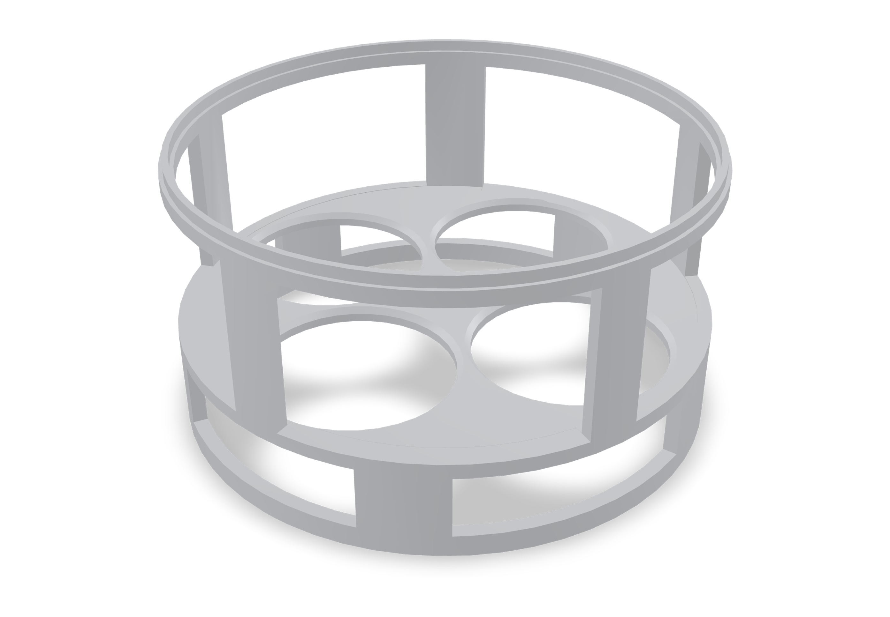
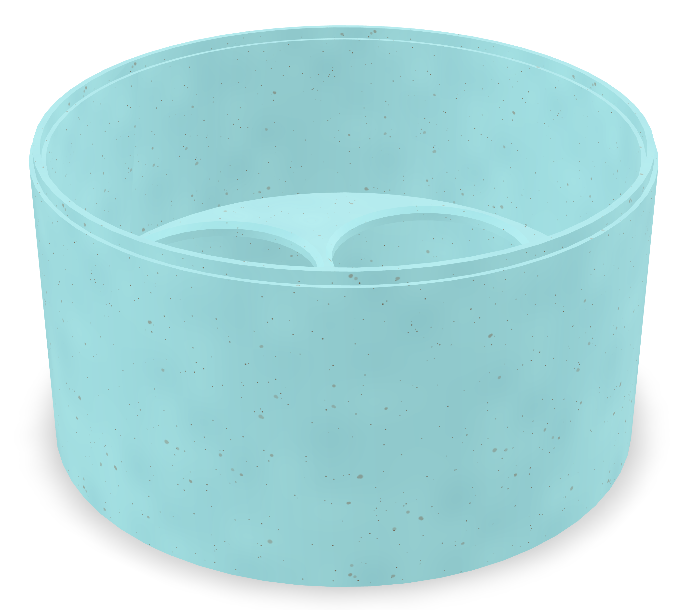

## The goal

FAR-OUT 2026-27 awards payload points for eggs that are launched and returned unbroken: **10 points per egg, up to 500 points**.

## Rules the design has to meet

- Independent of any critical part of the rocket's structure
- At least 1 kg
- Rigidly secured
- Hits the ground at **25 ft/s or less**
- No animals
- Eggs are marked by competition staff

## Work so far

Modified the existing egg holder CAD and 3D printed a PLA prototype. Print settings were tuned for strength and fit: **3 perimeters, 20% cubic infill**.

## Two iterations

Both versions hold four eggs in the same plate with four circular cutouts, and both fit the same 120.6 × 63.5 × 120.7 mm envelope. The difference is the outer wall.

| | Lightweight (Rev A) | Full (Rev B) |
|---|---|---|
| Outer wall | Two rings joined by vertical struts | Solid cylinder |
| Material volume | 38.5 cm³ | 85.0 cm³ |
| Mass if printed solid in PLA | 47.8 g | 105.4 g |

Volumes are measured from the STL exports. Solid PLA mass uses a density of 1.24 g/cm³ and is an upper bound, since the parts print with partial infill.

The lightweight version uses **55% less material**. The question the two versions answer: is the extra stiffness of a solid wall worth more than doubling the mass?

Both are rotatable in 3D at the top of this page, and in the CAD library: [lightweight](/cad/egg-holder-light/), [full](/cad/egg-holder-full/).

PLACEHOLDER: Which version you picked and why, once you have print weights or drop test results.

## Design thinking

An egg breaks when force is concentrated on a small area of the shell. That makes this the opposite problem from a gripper's serrated teeth (see the [robotic arm](/work/robotic-arm/)): the holder should spread the load over as much of the shell as possible to keep the pressure low.

PLACEHOLDER: How the prototype holds each egg, what you changed from the original CAD, and test results once you have them.
