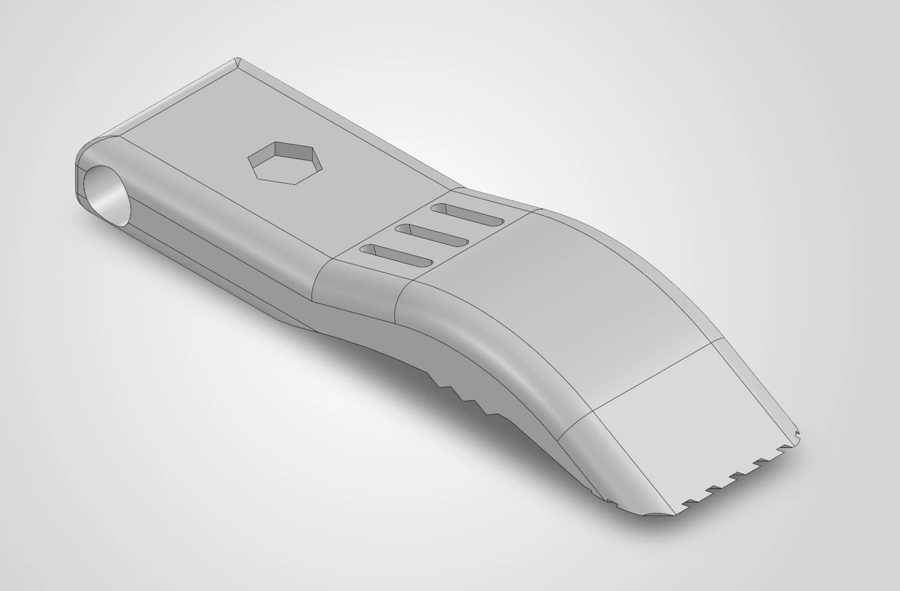
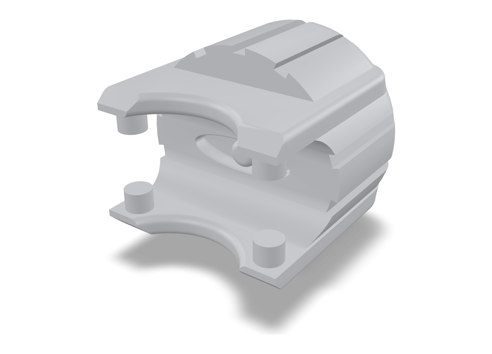
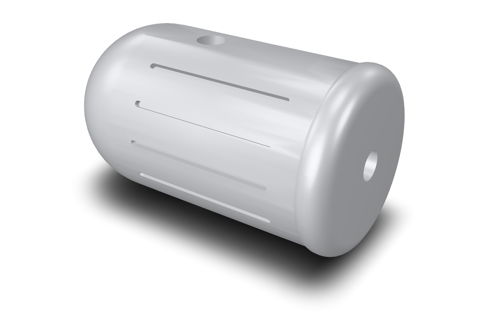

## Objective

PLACEHOLDER: One or two sentences. What should the arm do when it is finished? How many joints, what reach, what should it pick up?

## Starting point

PLACEHOLDER: I am building this by following a tutorial series, then changing it. Write down here which parts follow the tutorial and which parts are your own decisions. Recruiters respect an honest "I learned this from X, then I changed Y because Z" much more than a copied model with no explanation.

## Gripper jaw

The first finished part is one jaw of the gripper.

Its features, in the order they were built:

| Feature | What it is |
|---|---|
| Boss-Extrude1, Fillet1 | Main curved body of the jaw, with rounded edges |
| Cut-Extrude1, Mirror1 | Shaping cuts, mirrored so both sides match |
| Cut-Extrude2 | Pivot hole at the base |
| Cut-Extrude4, LPattern3 | Three slots across the middle, made once and patterned |
| Cut-Extrude5, LPattern4 | Serrated teeth on the gripping face, made once and patterned |
| Hex pocket | Six sided pocket on the top face |

### Why the features are there

**Hex pocket.** A hex nut sits inside the pocket and can't rotate, so the bolt can be tightened or loosened from the other side with one tool. This is called a captive nut.

**Three slots.** They cut material and weight, which also means a shorter print and less filament. PLACEHOLDER: confirm against the tutorial whether they have another purpose.

**Serrated teeth.** The teeth put the same grip force onto a much smaller area, so the pressure on the object goes up and the teeth dig in slightly. That locks the object in place instead of relying only on friction, which (F = μN) doesn't depend on contact area.

## Gripper actuator

The second finished part drives the gripper. It fits in a 31.0 × 30.9 × 35.0 mm envelope and uses 16.5 cm³ of material, measured from the STL export.

PLACEHOLDER: How the actuator moves the jaws, and how it connects to the jaw's pivot hole.

## Wrist module

The third part is the wrist. It fits in a 55.0 × 31.0 × 31.0 mm envelope and uses 32.5 cm³ of material, measured from the STL export.

PLACEHOLDER: What motion the wrist gives the arm, and how it connects to the gripper actuator.

## Rotary yoke joint

The fourth part is a rotary yoke joint. It fits in a 68.0 × 40.0 × 44.0 mm envelope and uses 15.7 cm³ of material, measured from the STL export.

PLACEHOLDER: Which axis this joint rotates about, and which parts it connects.

## Next

- [x] Gripper jaw
- [x] Gripper actuator
- [ ] Base and turntable
- [ ] Shoulder and elbow joints
- [x] Wrist
- [x] Rotary yoke joint
- [ ] Full assembly and motion study
